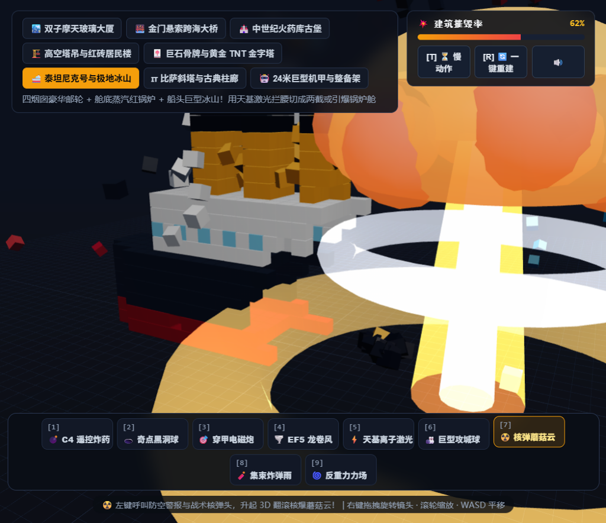

<p align="center">
  
  
</p>

# Voxel Demolition 3D v2.0 ☢️💣（3D 物理承重拆迁爆破游乐场）

**在线即玩地址 (GitHub Pages)**：https://dyc19991225.github.io/voxel-demolition/

基于 **Three.js (`InstancedMesh`) + GLSL + WebAudio** 零外部资产纯代码打造的浏览器版《拆迁 Teardown》解压破坏沙盒：单次 DrawCall 渲染高达 5000 块物理体素、**真实 6 邻域地基承重连通性 BFS 连锁坍塌**、高空坠落炸药箱二次殉爆、**8 座世界地标关卡** × **9 种奇葩战略级拆迁重武**，以及一键 `0.2×` 灾难大片慢动作！

---

## 核心好玩亮点

### 1. 真实物理承重与连锁坍塌引擎
- **6 邻域地基连通性实时解算**：炸断摩天大楼底层的 4 根承重钢柱、比萨斜塔倾斜侧底座，或切断跨海大桥桥塔，悬空的上千块楼体将失去支撑整体倾覆下坠，并在砸地瞬间飞溅弹跳！
- **高空坠落 TNT 连环殉爆**：悬吊在塔吊上的炸药箱、泰坦尼克号底舱的红热锅炉、巨型机甲胸口的反应堆核心，一旦随废墟高速坠地撞击（`|vy| > 6.5`），将触发震撼连环二次爆炸！

### 2. 九大奇葩拆迁重武（数字键 `1`–`9` 秒切）
- **`[1]` 💣 C4 遥控炸药包**：随手贴满大楼四角承重柱，按 **`[E / Space]`** 依次延时 85ms 连环引爆！
- **`[2]` 🕳️ 奇点黑洞球**：发射紫色引力奇点与吸积盘，把整面大楼墙体撕扯卷入旋转星环，2.3 秒后超新星轰然炸裂！
- **`[3]` 🎯 穿甲电磁炮**：超音速一炮洞穿三层城墙直击古堡地下火药库或机甲胸口反应堆！
- **`[4]` 🌪️ EF5 狂暴龙卷风**：召唤移动漏斗风柱，把整栋红砖楼卷上高空！
- **`[5]` ⚡ 天基离子激光**：按住左键拖拽天基橙白光柱，像切豆腐一样把泰坦尼克号与跨海大桥拦腰切成两截！
- **`[6]` 🎳 巨型攻城铁球**：投掷重型实心铁球推倒巨石多米诺骨牌阵！
- **`[7]` ☢️ 战术核弹蘑菇云（v2.0 新增）**：拉响防空警报并空投战术核弹头，触地瞬间爆发致盲热闪光、马赫地面尘浪环、白色威尔逊凝结云裙与拔地而起的 **3D 翻滚核爆蘑菇云**！
- **`[8]` 🧨 集束炸弹雨（v2.0 新增）**：召唤 14 枚高空子母弹地毯式覆盖轰炸！
- **`[9]` 🌀 反重力升天场（v2.0 新增）**：开启双环失重矩阵把整片建筑拔地悬空漂浮，2.1 秒后重力反转猛烈砸地粉碎！

### 3. 八大可摧毁立体地标 + `$gamefeel-3d` 满格视听爽感（100/100 Grade S）
1. **🏙️ 双子摩天玻璃大厦**：底层 4 根承重钢柱架空 + 高空玻璃连廊
2. **🚢 泰坦尼克号与极地冰山（v2.0 新增）**：四烟囱豪华邮轮 + 舱底蒸汽红锅炉 + 船头巨型冰山
3. **🇮🇹 比萨斜塔与古典柱廊（v2.0 新增）**：7 层渐进倾斜白色大理石拱塔 + 顶层黄金大钟与引信
4. **🤖 24米巨型机甲与整备架（v2.0 新增）**：双腿承重高达风巨型机甲 + 光束巨剑 + 胸口反应堆核心
5. **🌉 金门悬索跨海大桥**：双红塔悬索桥 + 桥面满载运油罐车
6. **🏰 中世纪火药库古堡**：四座角楼 + 中央主堡地下塞满 TNT 火药桶
7. **🏗️ 高空塔吊与红砖居民楼**：纤细黄色塔吊悬臂下挂满炸药箱，炸断吊索直接砸穿 8 层红砖楼
8. **🀄 巨石骨牌与黄金 TNT 金字塔**：7 根高耸巨石骨牌直指终点黄金 TNT 金字塔

- 按 **`[T]`** 一键开启 **`0.2×` 灾难大片慢动作 + WebAudio 720Hz 低通深潜音效**；
- 配备 GLSL 菲涅尔爆破气浪穹顶、GDC `Trauma²` 三轴旋转震屏与零 MP3 合成防空警报/核爆轰鸣/碎玻璃/废墟崩塌声（通过 `gamefeel-3d doctor` **100/100 Grade S** 认证）。

---

## 本地运行

```bash
npm install
npm run dev
npm run build
```

## License

MIT © dyc19991225
