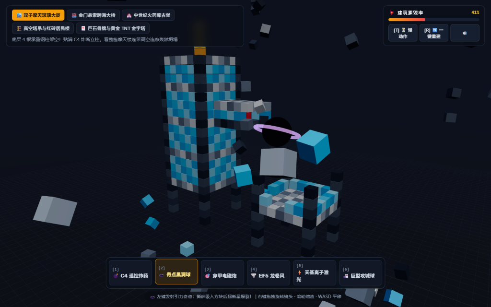

<p align="center">
  
</p>

# Voxel Demolition 3D 💣（3D 物理承重拆迁爆破游乐场）

**在线即玩地址 (GitHub Pages)**：https://dyc19991225.github.io/voxel-demolition/

基于 **Three.js (`InstancedMesh`) + GLSL + WebAudio** 零外部资产纯代码打造的浏览器版《拆迁 Teardown》解压沙盒：支持单次 DrawCall 渲染数千体素方块、**真实承重连通性 BFS 连锁坍塌**、高空坠落炸药箱二次殉爆、6 种奇葩重火力武器与 `0.2×` 灾难大片慢动作！

---

## 核心好玩亮点

### 1. 真实物理承重与连锁坍塌引擎
- **6 邻域地基连通性实时解算**：炸断摩天大楼底层的 4 根承重钢柱或切断悬索桥塔，悬空的上千块楼体将失去支撑整体倾覆下坠，并在砸地瞬间飞溅弹跳！
- **高空坠落 TNT 连环殉爆**：悬吊在塔吊上的炸药箱或夹在楼层里的燃气罐，一旦随废墟高速坠地撞击（`|vy| > 6.5`），将触发震撼连环二次爆炸！

### 2. 六大奇葩拆迁重武（数字键 `1`–`6` 秒切）
- **`[1]` 💣 C4 遥控炸药包**：随手贴满大楼四角承重柱，按 **`[E / Space]`** 依次延时 85ms 连环引爆！
- **`[2]` 🕳️ 奇点黑洞球**：发射紫色引力奇点与吸积盘，把整面大楼墙体撕扯卷入旋转星环，2.3 秒后超新星轰然炸裂！
- **`[3]` 🎯 穿甲电磁炮**：超音速一炮洞穿三层城墙直击古堡地下火药库！
- **`[4]` 🌪️ EF5 狂暴龙卷风**：召唤移动漏斗风柱，把整栋红砖楼卷上高空！
- **`[5]` ⚡ 天基离子激光**：按住左键拖拽天基橙白光柱，像切豆腐一样把跨海大桥与摩天楼横切成两半！
- **`[6]` 🎳 巨型攻城铁球**：投掷重型实心铁球推倒巨石多米诺骨牌阵！

### 3. 五大可摧毁立体地标 + `$gamefeel-3d` 满格视听爽感
- 内置 **双子摩天玻璃大厦、金门悬索跨海大桥、中世纪火药库古堡、高空塔吊与红砖工地、巨石骨牌与 TNT 金字塔** 5 张大地图；
- 按 **`[T]`** 一键开启 **`0.2×` 灾难大片慢动作 + WebAudio 720Hz 低通深潜音效**；
- 配备 GLSL 菲涅尔爆破气浪穹顶、GDC `Trauma²` 三轴旋转震屏与零 MP3 合成爆破/碎玻璃/废墟轰鸣声（`gamefeel-3d doctor` 满分认证）。

---

## 本地运行

```bash
npm install
npm run dev
npm run build
```

## License

MIT © dyc19991225
